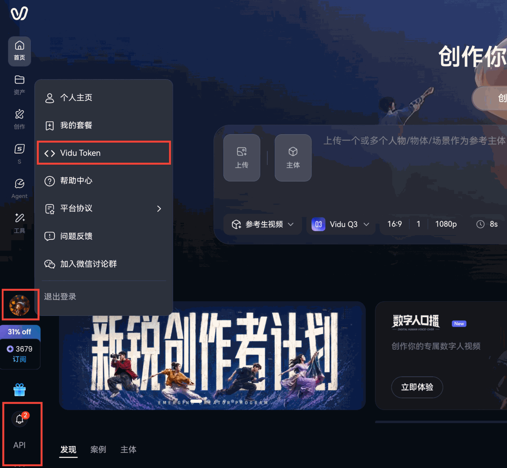
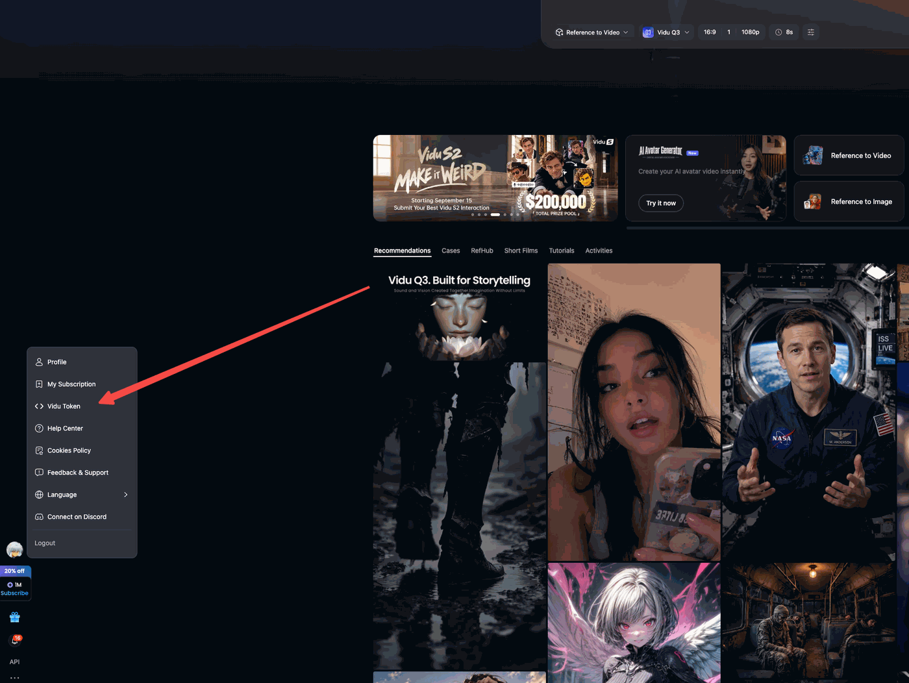

# Vidu Skills

[English](./README.md)

通过 `vidu-cli` 生成和交付 Vidu 视频、图像与语音，管理任务、参考素材、作品及个人克隆音色。

**CLI技能 1.5.0 要求 vidu-cli v0.2.36 或更新版本**，以 v0.2.36（`6bb4b07`）为同步基准。使用宿主提供的命令执行工具，不依赖特定批量编排工具。

Agent 已连接 Vidu MCP 时，使用独立的 [Vidu MCP Skill](mcp/vidu-mcp/SKILL.md)。该入口使用已连接的账号和当前工具Schema，无需安装CLI或在本地设置 `VIDU_TOKEN` 环境变量。仓库根目录的CLI Skill继续服务命令行工作流。

## MCP 与 WorkBuddy

MCP Skill正文和参考文件仅在本仓库维护。WorkBuddy连接器配置、打包器及打包测试在Unidu仓库维护。打包器读取指定的vidu-skills checkout；Unidu不保存Skill正文副本，MCP服务运行时不加载Skill。仅连接MCP不会自动安装Skill。

MCP Skill采用独立发布版本，与CLI Skill、连接器包和MCP协议日期分别管理。唯一机器版本源为 [compatibility.json](mcp/vidu-mcp/compatibility.json)：`skill_version` 标识Skill版本；`mcp_server.min_version` 为支持下界（包含），`max_version_exclusive` 为上界（不包含）。执行业务前，Agent按Skill调用 `get_server_info`，检查服务器身份为 `vidu`，并将其稳定 `X.Y.Z` 版本与该范围比较。版本不可得或不兼容时停止流程，提示适当升级／重连服务器或安装兼容的Skill版本。

MCP Skill发布时，兼容新增能力递增minor，破坏接口要求递增major，文字修正递增patch；支持的服务器契约变化时在manifest中调整范围。版本支持声明仍须经过Schema和工作流验证，处于范围内不代表自动保证所有操作兼容。

MCP上传通过文字指导Agent把本地文件原始字节发送到签名地址、确认真实ETag，并等待素材准备至ready。Agent使用宿主已有的本地文件与HTTP能力，不依赖预置传输脚本。

在Unidu checkout中构建国内和海外WorkBuddy ZIP，用 `--skills-dir` 指定本仓库路径。两个包共用MCP Skill正文和参考文件，区域差异由连接器元数据提供。命令与交付细节见Unidu的 `integrations/workbuddy/README.md`。打包不会自动发布连接器，也不代表服务入口已经部署。

## 功能

| 能力 | 说明 |
|---|---|
| 文生图 / 参考生图 | 增加 `3.2_image_2_5_fast`、`3.2_image_2_5_pro`，支持 1080p/2k/4k |
| 文生视频 | 支持旧模型、Q3.1 Drama、Wan 3；按模型最长可生成 30 秒 |
| 图生 / 首尾帧生视频 | 单张图片或按顺序提供首尾帧，支持范围取决于模型 |
| 参考生视频 | 图片/素材及支持的音频、视频输入；Q4、Drama、Wan 3 分别有独立限制，也支持相应的纯音频参考流程 |
| 文字转语音 / 口型同步 | 共用官方声音池；个人克隆音色可用于 TTS |
| 视频合成 | 视频、音频、字幕、特效多轨时间线导出 |
| 任务管理 | 历史、详情、等待、下载、取消和删除历史记录 |
| 复用 / 后处理 | 历史任务重跑、视频延长、图片增强、视频超分 |
| 参考素材 / 作品 | 创建和管理素材、社区搜索与收藏、作品列表与收藏 |
| 个人克隆音色 | 创建、列表、查询、等待、更新，以及显式申请试用 |
| 报价 / 账户 | 生成、TTS、口型同步、超分积分预估；通行证配额、积分余额及流水 |

`--with-audio` / `--with-audio=false` 控制输出音频，与提供参考音频的 `--audio` 分开使用。调度模式为 `nopeak`（**闲时模式**）、`claw_pass`（**通行证模式**）、`normal`（**积分模式**）。Q4 默认积分模式，也支持服务端校验的闲时模式，不支持通行证模式；Drama、Wan 3 仅支持积分模式。选择设置前请查看[模型与参数参考](references/parameters.md)，不因新增模型自动替换用户选择。

## 作为 Agent Skill 安装

```bash
# 通过 npx skills（推荐，支持 Claude Code、Cursor、Copilot 等 40+ agents）
npx skills add shengshu-ai/vidu-skills

# 通过 ClawHub（OpenClaw 生态）
clawhub install github:shengshu-ai/vidu-skills
```

## 安装 vidu-cli

需要 Node.js ≥ 14，CLI **v0.2.36+**：

```bash
npm install -g vidu-cli@latest
vidu-cli --version
```

若显示的 CLI 版本低于 v0.2.36，先升级再使用技能，不维护旧版命令降级流程。

## 环境变量

| 变量 | 必填 | 说明 |
|------|------|------|
| `VIDU_TOKEN` | 是 | Vidu API Token —— 在 [vidu.cn](https://www.vidu.cn)（中国大陆）或 [vidu.com](https://www.vidu.com)（海外）获取，详见[获取 Vidu API Token](#获取-vidu-api-token) |
| `VIDU_BASE_URL` | 否 | 默认 `https://service.vidu.cn`（中国大陆）；海外用 `https://service.vidu.com` |
| `VIDU_DEBUG` | 否 | 设为 `1` 可打印完整响应体到 stderr |

### 获取 Vidu API Token

中国大陆 —— 访问 [vidu.cn](https://www.vidu.cn)，登录后点击左下角头像打开账户菜单，选择 **Vidu Token**：



海外 —— 访问 [vidu.com](https://www.vidu.com)，登录后点击左侧边栏头像打开账户菜单，选择 **Vidu Token**：



## 数据使用与隐私

本 Skill 会把用户提供的数据发送到 Vidu 服务器：

- 文本提示词会发送到 Vidu API。
- 本地图片、视频、音频文件作为任务输入使用时，会上传到 Vidu API 服务器（`service.vidu.cn` 或 `service.vidu.com`）。
- 任务参数（如设置、模型版本、时长、分辨率等）会发送到 Vidu API。
- 用于个人音色克隆的录音会上传，用于审核与克隆。

使用本 Skill 前，请确认将相关内容发送给 Vidu 符合你的隐私和知识产权要求。数据处理遵循 Vidu 官方政策。

安全建议：

- 如有可能，创建权限范围受限的 Token。
- 初次测试时避免使用生产环境或高权限 Token。
- 查看 Vidu 服务条款和隐私政策。

Vidu 条款与隐私：

- 海外：https://www.vidu.com/terms
- 中国大陆：https://www.vidu.cn/terms

## 快速上手

```bash
# 使用原有模型，等待完成并下载。
vidu-cli task submit --type text2video --prompt "一只猫在草地上奔跑" \
  --model-version 3.2 --duration 5 --resolution 1080p --wait --output ./output

# 查询历史，再使用响应中的任务 ID 继续操作。
vidu-cli task list --state success --pagesz 20
vidu-cli task get "$TASK_ID" --details
vidu-cli task wait "$TASK_ID" --timeout 1800 --output ./output

# 3.2 图生视频需要同时填写分辨率和转场。
vidu-cli task submit --type img2video --prompt "镜头缓慢推进" \
  --image ./photo.jpg --model-version 3.2 --duration 5 --resolution 1080p \
  --transition pro --wait --output ./output

# 从响应中选择真实的官方声音 ID，不自行编造。
vidu-cli task tts-voices
# 将 OFFICIAL_VOICE_ID 设为选中的响应 ID。
vidu-cli task tts --prompt "你好，欢迎使用 Vidu，一起开始新的故事。" \
  --voice-id "$OFFICIAL_VOICE_ID" --wait --output ./audio
```

`TASK_ID`、音色 ID、分页 token 必须取自响应；示例中的数字作品 ID、标签 ID、上传 ID 均为占位值。任务 ID 与作品 ID 不可互换。脚本使用默认 JSON 输出，人工查看可用 `vidu-cli --format table task list`。

### 新模型与输出音频

```bash
# Wan 3 报价与生成使用相同的输出音频选择。
# 两者均使用模型默认值：5 秒、720p、16:9、normal 积分模式。
vidu-cli task cost --type text2video --model-version viduq2-drama-std --with-audio
vidu-cli task submit --type text2video --prompt "海浪拍打沙滩的声音" \
  --model-version viduq2-drama-std --with-audio --wait --output ./output

# Drama 纯音频参考：本地 WAV/MP3，4–30 秒且不超过 15 MiB。
vidu-cli task submit --type character2video --prompt "带有对白的戏剧场景" \
  --model-version viduq3.1-drama-std --audio ./dialogue.wav --wait --output ./output

# 新图片模型；图片任务无需填写 --duration。
vidu-cli task submit --type text2image --prompt "文字清晰的海报" \
  --model-version 3.2_image_2_5_pro --resolution 2k --wait --output ./images
```

Q4（`3.4`）支持 `img2video`（3–16 秒）和 `character2video`（1–16 秒），需显式填写时长与分辨率。Drama 为 `viduq3.1-drama-std`（4–30 秒），Wan 3 为 `viduq2-drama-std`（2–30 秒）。参考输入规则各不相同，不能统一限制为 1–7 个图片/素材。原有 `3.2_a` 模型也支持 720p。

### 视频超分与个人音色

```bash
# 报价不会上传本地视频或创建任务。
vidu-cli task upscale-cost --video ./input.mp4 --resolution 4k
# 用户需要实际超分时，使用相同输入与设置提交。
vidu-cli task upscale --video ./input.mp4 --resolution 4k --wait --output ./output

# 本地录音为 10–300 秒、不超过 20 MiB；音色克隆默认付费。
vidu-cli voice create --audio ./voice-sample.wav --name "我的旁白" --wait
# 将 VOICE_ID 设为 create/list 响应中的 ID，使用已完成的个人音色。
vidu-cli task tts --prompt "欢迎收听，我们的故事即将进入新的篇章。" \
  --voice-id "$VOICE_ID" --wait --output ./audio
```

超分使用已有视频 `--creation-id` 或 `--video`，两者互斥。作品/本地视频自动读取时长；URL/`ssupload` 输入必须提供完整源视频的 `--duration`。音色试用需显式指定 `--use-trial`，失败不会自动改为付费创建。详见[任务流程](references/task_workflows.md)、[个人音色](references/voices.md)。

## 命令速查

以下命令均使用 `vidu-cli` 前缀。创建任务的命令支持 `--wait [--timeout SECONDS] [--output PATH]`，其中 timeout/output 需要 wait。合法别名包括 `--model`、`--voice`、`--prompt-file` 和 `img2image`，示例优先使用完整名称。

| 命令 | 用途 |
|---|---|
| `vidu-cli upload IMAGE_PATH` | 上传本地图片，返回 `upload_id`、`ssupload_uri` |
| `vidu-cli task submit --type ... --model-version ...` | 提交图片/视频生成 |
| `vidu-cli task list` | 历史记录，支持重复状态/类型/场景筛选与游标分页 |
| `vidu-cli task get TASK_ID [--details] [-o PATH]` | 单次查询，可查看输入/设置/作品详情或下载 |
| `vidu-cli task wait TASK_ID` | 等待完成，可设置超时、轮询间隔和下载 |
| `vidu-cli task cancel TASK_ID` | 处理开始前取消，具体限制由服务端校验 |
| `vidu-cli task delete TASK_ID` | 软删除符合条件的任务历史 |
| `vidu-cli task rerun TASK_ID` | 使用历史生成输入创建新任务 |
| `vidu-cli task extend --creation-id ... --duration ...` | 将符合条件的已完成 1080p 视频延长 1–7 秒 |
| `vidu-cli task upscale-image --creation-id ...` | 图片增强，默认 2k |
| `vidu-cli task upscale --creation-id ... --resolution ...` | 视频超分，也可使用 `--video` 输入 |
| `vidu-cli task upscale-cost --video ... --resolution ...` | 超分报价，不上传素材或创建任务 |
| `vidu-cli task compose --timeline ...` | 导出多轨时间线 |
| `vidu-cli task lip-sync --video ... --text ...` | 文本驱动口型同步，也可使用 `--audio` |
| `vidu-cli task tts --prompt ... --voice-id ...` | 语音生成，也可使用提示词文件或重复文本段 |
| `vidu-cli task tts-voices` | 列出官方静态声音池 |
| `vidu-cli task lip-sync-voices` | 列出同一官方声音池 |
| `vidu-cli task cost --type ... --model-version ...` | 图片/视频生成报价 |
| `vidu-cli task tts-cost --text ... --voice-id ...` | TTS 报价 |
| `vidu-cli task lip-sync-cost --duration ...` | 口型同步报价 |
| `vidu-cli element check --name ...` | 检查素材名称是否可用 |
| `vidu-cli element preprocess --name ... --image ...` | 预处理参考图片 |
| `vidu-cli element create --name ... --image ...` | 使用 1–3 张图片创建可复用素材 |
| `vidu-cli element get ELEMENT_ID` | 获取最新可见素材 |
| `vidu-cli element update ELEMENT_ID ...` | 改名、整体替换/清空标签或修改描述 |
| `vidu-cli element delete ELEMENT_ID` | 删除个人素材 |
| `vidu-cli element list` | 个人素材，支持游标或数字页兼容模式 |
| `vidu-cli element search --keyword ...` | 社区搜索，可按类别/主题筛选 |
| `vidu-cli element favorites` | 游标分页查询收藏的社区素材 |
| `vidu-cli element favorite ELEMENT_ID` | 收藏素材，由 CLI 内部解析 share ID |
| `vidu-cli element unfavorite ELEMENT_ID` | 取消收藏素材 |
| `vidu-cli creation list [--favorites-only]` | 个人/收藏作品，数字分页 |
| `vidu-cli creation favorite CREATION_ID` | 收藏可访问的作品 |
| `vidu-cli creation unfavorite CREATION_ID` | 取消收藏作品 |
| `vidu-cli voice create --audio ... [--use-trial]` | 克隆个人音色，可等待完成 |
| `vidu-cli voice list` | 游标分页查询个人音色 |
| `vidu-cli voice get VOICE_ID` | 获取克隆状态快照 |
| `vidu-cli voice update VOICE_ID ...` | 更新名称/描述 |
| `vidu-cli voice wait VOICE_ID` | 通过 SSE 等待，无轮询间隔参数 |
| `vidu-cli quota pass` | 通行证配额，不代表闲时模式配额 |
| `vidu-cli quota credit` | 积分余额 |
| `vidu-cli quota records` | 积分流水，从 0 开始的数字分页 |

## 任务交付与错误

任务终态为 `success`、`failed`、`canceled`，其他状态继续等待。成功的 `task get` 请求也可能查询到失败任务，必须分别检查 `state` 与 `ok`。等待进度写入 stderr，最终运行结果 JSON 写入 stdout；参数解析错误为 stderr 文本，退出码为 2。

多产物或 TTS 音频附带字幕 JSON 时使用输出目录；存在字幕时会下载 `{task_id}_subtitle.json`。单产物可指定文件路径。多段 TTS 需要 `--subtitle-enable false`，提示词/文件或单段 `--text` 默认支持字幕。

等待超时或中断不会取消服务端任务或音色克隆，应使用原任务/音色 ID 继续查询。提交结果不明确时不要盲目重提；闲时模式/通行证模式请求被拒绝后，不自动切换积分模式；试用失败不自动改为付费克隆。详见[错误与重试](references/errors_and_retry.md)。

## 参考文档

| 文件 | 内容 |
|---|---|
| [安装设置](references/setup.md) | 安装、最低版本、凭证、环境变量 |
| [参数参考](references/parameters.md) | 模型、素材限制、生成/TTS/口型同步参数、调度、报价、配额 |
| [任务流程](references/task_workflows.md) | 历史、交付、重跑、延长、图片/视频超分 |
| [资产管理](references/assets.md) | 素材、社区收藏、作品、ID 与分页 |
| [个人音色](references/voices.md) | 克隆、查询、等待、更新、试用及用于 TTS |
| [视频合成](references/compose.md) | 时间线 JSON schema 与导出 |
| [错误与重试](references/errors_and_retry.md) | 输出通道、状态、错误上下文、恢复方式 |

## 链接

- 官网（中国大陆）：https://www.vidu.cn/
- 官网（海外）：https://www.vidu.com/
- npm：https://www.npmjs.com/package/vidu-cli
